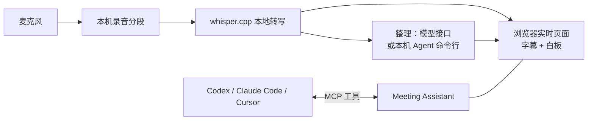

# Meeting Assistant

为 AI 编程助手准备的会议工具：在会话里说一声“开始开会”，它就用本机麦克风录音、在本地实时转写，把讨论自动整理成白板，会中随时回答“刚才说到哪了”，会后按规范写出会议纪要。

<p align="center"><a href="https://github.com/JacobeanJiang/meeting-plugin/raw/main/assets/demo.mp4"></a></p>
<p align="center"><a href="https://github.com/JacobeanJiang/meeting-plugin/raw/main/assets/demo.mp4">下载高清版（MP4，1080p，36 秒，有音效）</a></p>

可以作为 **Codex、Claude Code 插件**一键安装，也可以作为 [MCP](https://modelcontextprotocol.io) 服务接入 **Codex、Claude Code、Cursor**，以及 Windsurf、Cline、Continue 等任何支持 MCP（stdio）的 Agent。

## 能做什么

- **本地实时转写**：麦克风录音按 10–30 秒分段，用 whisper.cpp 在本机识别（默认 large-v3-turbo 量化模型），音频不出本机。
- **流式字幕**：边说边出字。正在说的话每隔一两秒重新识别一次，以灰色草稿显示在会议页（Apple M4 实测说话后约 5–8 秒出现，每 5 秒左右更新），所在分段识别完成后替换为正式字幕。Agent 读取会议时也能拿到这段草稿（`liveCaption`）。默认开启，设 `MEETING_LIVE_CAPTIONS=0` 可关闭。支持中文、英文、日语、韩语及自动检测；中文可统一为简体或繁体，可添加专有名词提升识别准确率，并自动过滤静音、识别噪音和重复句。也可以改用自己配置的第三方识别模型（任何 OpenAI 兼容的 `/audio/transcriptions` 接口，例如 OpenAI、Groq、硅基流动或自建的 whisper 服务，见下方“使用第三方语音识别模型”），流式字幕和正式字幕都会走这个接口，某段失败时自动改用本机识别；不配置时音频不出本机。
- **AI 校对字幕**：每段字幕识别后，由整理用的同一个模型结合上下文和专有名词改同音错字、补标点、去口头禅，原文保留、可随时切换查看；校对结果长短变化太大时不采用。默认开启，可在会议页设置中关闭，或从当前平台读取到的模型列表中另选一个（Codex、Cursor 从命令行读取，Claude Code 提供 sonnet、opus、haiku，模型接口读取 /models）。
- **会议实时页面**：开会后打开一个本地页面（Codex 桌面版会放在右侧内置浏览器里），左侧是白板，右侧是实时字幕，顶部显示录音状态、时长和音量；可以暂停、继续、结束，也可以切换查看历史会议。页面在窄窗口里会收成一行工具栏，字幕改为按需展开，白板也会改用更窄的排版、每个议题最多显示 5 条，让侧栏里也能看清。
- **自动整理的白板**：先听一会儿，判断出会议主题后再开始绘制，按讨论推进逐步追加，不会推翻已有内容。默认画成思维导图，支持五种形式：
  - 思维导图：中心主题 → 议题 → 观点（默认）
  - 议题分区、流程线、方案对比、进度看板
  观点按类型区分（观点、方案、风险、结论、待办、待确认），每条都能追溯到原话；白板可以直接编辑，人工改动会被保留。
- **会中 AI 执行**：会上直接点名助手派活，例如“AI助手，帮我查一下上季度流水，和去年同期比一下”。服务会识别出这句请求，交给你电脑上安装的 Codex、Claude Code 或 Cursor 在后台执行（可以读写文件、跑命令、联网），结果几秒到几分钟后出现在会议页面的“AI 执行”栏里，并弹出提示。助手的称呼和唤醒词可以自定义。
  还可以在会议页设置里添加**自定义场景**：写下“什么时候”（例如“会上提到线上问题、报错或 bug”）和“让 AI 做什么”（例如“整理成一条缺陷描述”），会上讨论到时不用点名，AI 也会提出任务。每个场景可选“先问我再执行”（默认开启），任务先等你在“AI 执行”里点“执行”或“忽略”。有启用的场景时，AI 会定期用新发言判断一次（用本机 Agent 命令行整理时约 90 秒一次），没有场景时不增加模型调用。
- **会中问答**：Agent 能读取白板、字幕和你在白板上选中的元素，回答“刚才定了什么”“谁负责什么”“这个结论的原话是什么”，也能按你的要求切换白板形式或修改白板。
- **会议纪要**：按一份完整的纪要规范生成 Markdown——会议概览、核心方向（议题 → 主题 → 要点）、关键决策、待办事项（含协作人与时间）。区分事实、观点与决策，不编造原文没有的内容，篇幅随会议长短自动控制。可导出为排版好的 HTML（适配手机与打印）；会议页顶部的“分享纪要”会把 HTML 纪要文件直接复制到剪贴板，粘贴到聊天窗口就能发给同事（macOS 已验证，Windows 未验证）。
- **导出与留存**：每场会议单独保存，可导出完整 Markdown（纪要、整理结果、全部转写）。

## 1.7.0 更新

- 会议页默认打开实时导图。宽屏左右交替显示议题，窄屏单列滚动。可展开更多要点，点击时间跳到对应字幕，或从右上角切换到可编辑白板。
- 长会议先分段提炼，再分别生成关键决策和待办。某个部分生成失败时，已完成的部分依然可查看。

## 工作方式



- **转写**默认完全在本机完成；配置了 `MEETING_ASR_MODEL` 时，每段录音和流式字幕草稿都发给所配置的语音识别接口，失败时这一段改用本机识别。可在会议页设置里切回“本机识别”。
- **实时白板整理**和**服务端生成纪要**默认直接用你电脑上的 Agent 命令行完成（Codex 用 `codex exec`，只读、低推理强度；也支持 Claude Code、Cursor），不需要 API Key，用的是你自己的 Agent 账号额度，大约每 90 秒整理一次。也可以配置一个 OpenAI 兼容的模型接口（OpenAI、DeepSeek、通义千问、OpenRouter、本地 Ollama 等），配置后改用这个接口，整理更快（约 40 秒一次）。转写文字只发送给其中一方。
- **既没有模型接口也没有 Agent 命令行**时：录音、字幕、会中问答照常，白板不会自动整理；纪要由你正在使用的 Agent 按同一份规范直接写出，再保存回会议。
- **会中 AI 执行**同样由本机的 Agent 命令行完成：Codex 用 `codex exec`，Claude Code 用 `claude -p`，Cursor 用 `cursor-agent -p`。默认按 Codex、Claude Code、Cursor 的顺序使用第一个已安装的；都没有安装时这一功能自动关闭，会议页面的“AI 执行”栏会说明原因。
- **多个会话一起用**：Agent 应用每开一个会话就会启动一个服务进程。第一个负责录音和保存，后开的会话会把操作转交给它，所以在哪个会话里都能开会、提问；负责的那个会话关闭后，其他会话会接着用同一份记录。

## 环境要求

- macOS 12 及以上（Apple Silicon / Intel）或 Windows 10 及以上（x64）
- Node.js 22 及以上
- 首次使用会自动下载识别模型（约 574 MB，huggingface.co 不可用时自动改用 hf-mirror.com，支持断点续传）；下载期间可以照常开会，录音先保存，模型就绪后自动补上转写。

## 安装

### 作为插件安装（推荐）

这个仓库本身就是一个插件市场，里面有构建好的插件：`meeting-assistant`（macOS）和 `meeting-assistant-windows`（Windows）。插件里已经包含 MCP 服务、录音和识别程序以及配套技能，不需要自己构建。只要电脑上装有 Node.js 22 或以上即可（macOS 版会自动在 nvm、Homebrew、Volta、fnm 的常见位置寻找 Node）。

**Codex**（命令行与桌面版共用）：

```bash
codex plugin marketplace add JacobeanJiang/meeting-plugin
codex plugin add meeting-assistant@meeting-assistant          # Windows 用 meeting-assistant-windows@meeting-assistant
```

添加市场后，也可以在 Codex 桌面版的「插件」页面找到 Meeting Assistant 并安装。

在命令行安装或升级后，请完全退出 Codex 桌面版（⌘Q）再重新打开：桌面版只在启动时读取插件列表，不重启时「自定义 → 插件 → 已安装」里看不到 Meeting Assistant，已经开着的会话也拿不到新版本的会议工具。

**Claude Code**：

```text
/plugin marketplace add JacobeanJiang/meeting-plugin
/plugin install meeting-assistant@meeting-assistant
```

整理模型等配置通过环境变量传入（见下方“配置”），插件会从启动 Agent 时的环境中读取；不配置也能使用，纪要由 Agent 按规范直接撰写。

### 手动接入 MCP 服务

Cursor 及其他 MCP 客户端，或者需要自行构建时，用这种方式：

```bash
git clone https://github.com/JacobeanJiang/meeting-plugin.git
cd meeting-plugin
npm ci
npm run build           # macOS：生成 dist-mcp/macos（需要 Xcode Command Line Tools）
npm run build:windows   # Windows 版：生成 dist-mcp/windows（在 macOS/Linux 上用 zig 交叉编译）
```

构建产物目录可以复制到任意位置（Windows 版整目录拷到 Windows 电脑即可），下文用 `<dir>` 指代它。服务入口是 `<dir>/server/index.mjs`；也可以直接使用仓库里 `plugins/meeting-assistant` 或 `plugins/meeting-assistant-windows` 这两个现成目录。

#### Codex


在 `~/.codex/config.toml` 中加入：

```toml
[mcp_servers.meeting-assistant]
command = "node"
args = ["<dir>/server/index.mjs"]
tool_timeout_sec = 120
env = { MEETING_LLM_API_KEY = "sk-...", MEETING_LLM_MODEL = "gpt-4.1-mini" }
```

把 `<dir>/skills/meeting-assistant` 复制到 `~/.codex/skills/`，Codex 会在你提到开会、会议纪要时自动按它的流程使用这些工具。

#### Claude Code

```bash
claude mcp add meeting-assistant --scope user \
  -e MEETING_LLM_API_KEY=sk-... -e MEETING_LLM_MODEL=gpt-4.1-mini \
  -- node <dir>/server/index.mjs
mkdir -p ~/.claude/skills && cp -R <dir>/skills/meeting-assistant ~/.claude/skills/
```

#### Cursor

在 `~/.cursor/mcp.json`（全局）或项目的 `.cursor/mcp.json` 中加入：

```json
{
  "mcpServers": {
    "meeting-assistant": {
      "command": "node",
      "args": ["<dir>/server/index.mjs"],
      "env": { "MEETING_LLM_API_KEY": "sk-...", "MEETING_LLM_MODEL": "gpt-4.1-mini" }
    }
  }
}
```

工具自带说明，Cursor 无需额外配置即可使用；如需固定流程，可把 `skills/meeting-assistant/SKILL.md` 的内容加为项目规则。

#### 其他 MCP 客户端

以 stdio 方式运行 `node <dir>/server/index.mjs`，按需传入下方环境变量即可。

## 使用

在 Agent 里直接说：

- “开始开会，主题是 S5 版本排期” —— 开始录音并在浏览器打开会议页面
- “刚才关于上线时间是怎么定的？” / “目前有哪些待办？” —— 基于白板和原话回答
- “把白板换成方案对比” / “重新整理一下白板”
- “暂停” / “继续” / “结束会议”
- 会上直接说：“AI助手，帮我把刚才的三个结论整理成待办” —— 后台执行，结果出现在会议页面
- “生成会议纪要” / “导出这场会议”
- “看一下昨天那场会的纪要”

首次录音时，系统会请求麦克风权限（macOS 上授权给运行 Agent 的应用，例如终端、Cursor）。会议进行期间请保持 Agent 会话打开；会话关闭时会自动结束录音，并把已录内容转写完、保存好。

## 配置

| 环境变量 | 说明 | 默认 |
|---|---|---|
| `MEETING_LLM_API_KEY` | 整理模型的 API Key（也会读取 `OPENAI_API_KEY`） | — |
| `MEETING_LLM_BASE_URL` | OpenAI 兼容接口地址，例如 `https://api.deepseek.com/v1`、`http://localhost:11434/v1` | `https://api.openai.com/v1` |
| `MEETING_LLM_MODEL` | 整理与纪要使用的模型 | `gpt-4.1-mini` |
| `MEETING_ASR_MODEL` | 云端语音识别模型，例如 `whisper-1`、`gpt-4o-mini-transcribe`、`whisper-large-v3`。不设置时只用本机识别，音频不上传 | — |
| `MEETING_ASR_BASE_URL` | 语音识别接口地址（OpenAI 兼容，调用 `<地址>/audio/transcriptions`），必须是 https（本机地址除外） | 同 `MEETING_LLM_BASE_URL` |
| `MEETING_ASR_API_KEY` | 语音识别接口的 API Key | 同 `MEETING_LLM_API_KEY` |
| `MEETING_ASR_TIMEOUT_MS` | 单次语音识别请求的超时时间（毫秒） | `60000` |
| `MEETING_LIVE_CAPTIONS` | 设为 `0` 关闭流式字幕，只在每段识别完成后显示字幕 | 开启 |
| `MEETING_LIVE_INTERVAL_MS` | 流式字幕两次识别之间的间隔（毫秒，500–10000）。使用按次计费的第三方接口时可调大以减少调用 | `1500` |
| `MEETING_TASK_RUNNER` | 会中 AI 执行（以及未配置模型接口时的白板整理、纪要）使用的 Agent：`auto`、`codex`、`claude`、`cursor`，或 `off` 关闭 | `auto` |
| `MEETING_ASSISTANT_NAME` | 会上点名助手用的称呼，也会作为专有名词提示给语音识别 | `AI助手` |
| `MEETING_WAKE_WORDS` | 其他也算点名的叫法，逗号分隔，例如 `小助,Codex` | — |
| `MEETING_TASK_CWD` | 后台执行任务时的工作目录 | `~/.meeting-assistant/tasks` |
| `MEETING_NODE` | macOS 插件使用的 Node.js 路径（自动查找失败时指定） | 自动查找 |
| `MEETING_ASSISTANT_HOME` | 会议记录、白板与模型的存放目录 | `~/.meeting-assistant` |
| `MEETING_OPEN_BROWSER` | 设为 `0` 时不自动打开浏览器，只返回页面地址 | `1` |

以上设置也可以写在 `~/.meeting-assistant/config.json`（或 `MEETING_ASSISTANT_HOME` 下的 config.json）里，键名与环境变量相同。Codex 桌面版等应用启动插件时通常读不到终端里设置的环境变量，推荐用这个文件。同一项同时出现时，环境变量优先。修改后需要完全退出并重新打开 Agent 应用。

识别模型、会议语言、简繁体、专有名词、静音过滤、分段时长、白板默认形式等，在会议页面右上角的设置中调整。

### 使用第三方语音识别模型

默认用本机的 whisper.cpp 识别，不需要任何配置。想换成其他识别模型时，新建 `~/.meeting-assistant/config.json`，填入接口地址、Key 和模型名：

```json
{
  "MEETING_ASR_BASE_URL": "https://api.groq.com/openai/v1",
  "MEETING_ASR_API_KEY": "gsk-...",
  "MEETING_ASR_MODEL": "whisper-large-v3-turbo"
}
```

| 服务 | `MEETING_ASR_BASE_URL` | `MEETING_ASR_MODEL` 示例 |
|---|---|---|
| OpenAI | `https://api.openai.com/v1` | `gpt-4o-mini-transcribe`、`whisper-1` |
| Groq | `https://api.groq.com/openai/v1` | `whisper-large-v3-turbo` |
| 硅基流动 | `https://api.siliconflow.cn/v1` | `FunAudioLLM/SenseVoiceSmall` |
| 自建服务（如 faster-whisper-server、LocalAI） | `http://127.0.0.1:8000/v1` | 按服务说明 |

要求是兼容 OpenAI 的 `POST <地址>/audio/transcriptions`（multipart 上传 WAV，返回 `{"text": "..."}`）。地址必须是 https，本机地址除外。保存后完全退出并重新打开 Agent 应用，再开始会议，`meeting_start` 返回的 `speechRecognition` 会显示正在使用的模型。开会中途想切回本机识别，在会议页右上角设置里选“本机识别”。流式字幕会按 `MEETING_LIVE_INTERVAL_MS` 的间隔多次调用接口，按次或按时长计费的服务可以把间隔调大，或设 `MEETING_LIVE_CAPTIONS=0` 关闭。

## MCP 工具

| 工具 | 作用 |
|---|---|
| `meeting_start` | 开始录音并打开会议页面 |
| `meeting_control` | 暂停、继续、结束 |
| `meeting_read` | 读取白板、整理结果、选中元素、字幕与纪要（支持分页与增量） |
| `meeting_wait_changes` | 等待会议出现新内容，用于跟进会议 |
| `meeting_set_layout` | 切换白板形式，或重新整理整场会议 |
| `meeting_write_board` | 按要求修改白板（带版本校验，不覆盖人工改动） |
| `meeting_minutes` | 生成或获取会议纪要；未配置模型时返回纪要规范，由 Agent 撰写 |
| `meeting_save_minutes` | 保存 Agent 写好的纪要并导出 HTML |
| `meeting_export` | 导出 Markdown 与 HTML 文件 |
| `meeting_list` / `meeting_open` | 查看历史会议、重新打开会议页面 |

## 隐私

- 默认音频只在本机处理。配置了 `MEETING_ASR_MODEL` 时，每段录音以及流式字幕正在识别的音频会上传到 `MEETING_ASR_BASE_URL` 指定的语音识别服务，同时附带专有名词列表，不附带其他会议内容；在会议页设置里选“本机识别”即可停止上传。转写完成后删除分段音频；识别失败的片段会保留音频以便重试。
- 会议记录、白板和导出文件都保存在 `MEETING_ASSISTANT_HOME` 下。
- 会议页面只监听 `127.0.0.1`，每场会议使用随机地址。
- 转写文字只会交给负责整理的一方：配置了模型接口时发给该接口；否则交给本机的 Agent 命令行（只读运行、不执行命令），由它按自己的配置调用模型。两者都没有时不发送。
- 会中 AI 执行时，任务内容和最近的发言会交给本机的 Agent 命令行，由它按自己的配置调用模型。为了在开会时无人值守地完成，后台执行**跳过逐项确认**（Codex 的 `--dangerously-bypass-approvals-and-sandbox`、Claude Code 的 `--dangerously-skip-permissions`、Cursor 的 `--force`），它可以在 `MEETING_TASK_CWD` 下读写文件和运行命令。不需要这一功能，或会议里可能有不可信的发言者时，请设置 `MEETING_TASK_RUNNER=off`。
- 同一个数据目录同一时间只有一个会议服务负责录音；其他会话的服务通过只监听 `127.0.0.1`、带随机口令（只有当前用户可读）的本地接口把操作转交给它。

## 第三方组件

- [voxtype](https://github.com/peteonrails/voxtype)（MIT）—— macOS 版随包附带其官方发布的识别程序
- [whisper.cpp](https://github.com/ggml-org/whisper.cpp)（MIT）—— Windows 版识别程序及识别模型
- [Open Artifact](https://github.com/JimLiu/open-artifact)（Apache-2.0）—— 白板编辑器
- [opencc-js](https://github.com/nk2028/opencc-js)（MIT、Apache-2.0）—— 简繁转换

详见 [NOTICE.md](NOTICE.md)。

## 许可证

本项目代码以 [MIT](LICENSE) 许可证开源；随附的第三方组件保留各自的许可证。

