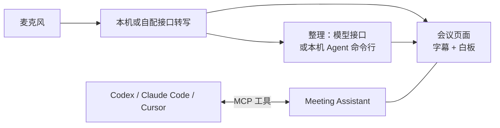

<div align="center">


# Meeting Assistant

**给 AI 编程助手用的会议工具。本机录音转写，白板自动成型，会后生成可核对原话的纪要。**

[](LICENSE)


[](https://modelcontextprotocol.io)

[快速开始](#快速开始) · [使用](#使用) · [配置](#配置) · [隐私](#隐私)

<a href="https://github.com/JacobeanJiang/meeting-plugin/raw/main/assets/demo.mp4"></a>

<sub><a href="https://github.com/JacobeanJiang/meeting-plugin/raw/main/assets/demo.mp4">观看高清版（1080p，41 秒，有音效）</a></sub>

</div>

在 Codex、Claude Code 或 Cursor 里说一声“开始开会”，就能录音、看实时字幕和白板，会中随时提问或派活，会后直接拿到纪要。

## 功能

- **本机实时转写**：whisper.cpp 在本地识别，边说边出字。AI 结合上下文校对错字和标点，原文可随时切回。支持中、英、日、韩。
- **白板自动成型**：讨论实时整理成导图，可切换思维导图、议题分区、流程线、方案对比和进度看板。白板可直接编辑，人工改动不会被覆盖。
- **会中 AI 执行**：会上说“AI助手，帮我查一下……”，任务交给本机的 Codex、Claude Code 或 Cursor 后台完成。也可以设定场景，讨论到相关内容时自动提出任务。
- **会中问答**：随时问“刚才定了什么”“谁负责什么”，回答可追溯到原话。
- **可核对的纪要**：自动生成概览、核心方向、关键决策和待办。纪要中的时间可跳回对应字幕，HTML 纪要一键复制分享。
- **转写服务可替换**：默认音频不出本机。也可以接入 OpenAI 兼容的转写接口，或自建流式转写与说话人识别服务。

## 快速开始

需要 macOS 12+ 或 Windows 10+，以及 Node.js 22+。首次开会会自动下载约 574 MB 的识别模型，下载期间录音照常保存。

**Codex**

```bash
codex plugin marketplace add JacobeanJiang/meeting-plugin
codex plugin add meeting-assistant@meeting-assistant   # Windows：meeting-assistant-windows@meeting-assistant
```

安装后完全退出并重新打开 Codex 桌面版，插件才会加载。也可以在桌面版的「插件」页面安装。

**Claude Code**

```text
/plugin marketplace add JacobeanJiang/meeting-plugin
/plugin install meeting-assistant@meeting-assistant
```

Windows 安装 `meeting-assistant-windows@meeting-assistant`。

<details>
<summary><b>Cursor 及其他 MCP 客户端</b></summary>

<br>

可以直接使用仓库里的 `plugins/meeting-assistant`（macOS）或 `plugins/meeting-assistant-windows`（Windows），也可以自行构建：

```bash
git clone https://github.com/JacobeanJiang/meeting-plugin.git
cd meeting-plugin
npm ci
npm run build           # macOS，输出到 dist-mcp/macos，需要 Xcode Command Line Tools
npm run build:windows   # Windows，输出到 dist-mcp/windows，在 macOS/Linux 上用 zig 交叉编译
```

下面用 `<dir>` 指代上述目录，服务入口是 `<dir>/server/index.mjs`。

Cursor：写入 `~/.cursor/mcp.json` 或项目的 `.cursor/mcp.json`。

```json
{
  "mcpServers": {
    "meeting-assistant": {
      "command": "node",
      "args": ["<dir>/server/index.mjs"]
    }
  }
}
```

Codex：写入 `~/.codex/config.toml`，再把 `<dir>/skills/meeting-assistant` 复制到 `~/.codex/skills/`。

```toml
[mcp_servers.meeting-assistant]
command = "node"
args = ["<dir>/server/index.mjs"]
tool_timeout_sec = 120
```

Claude Code：

```bash
claude mcp add meeting-assistant --scope user -- node <dir>/server/index.mjs
mkdir -p ~/.claude/skills && cp -R <dir>/skills/meeting-assistant ~/.claude/skills/
```

Windsurf、Cline、Continue 等客户端以 stdio 方式运行 `node <dir>/server/index.mjs` 即可。

</details>

## 使用

直接对 Agent 说：

| 说法 | 结果 |
|---|---|
| “开始开会，主题是 S5 版本排期” | 开始录音并打开会议页面 |
| “刚才上线时间是怎么定的？” | 根据白板和原话回答 |
| “AI助手，把刚才的三个结论整理成待办” | 后台执行，结果显示在会议页面 |
| “把白板换成方案对比” | 切换白板形式 |
| “暂停” / “继续” / “结束会议” | 控制录音 |
| “生成会议纪要” / “导出这场会议” | 生成纪要，导出 Markdown 与 HTML |

首次录音时，系统会请求麦克风权限。开会期间请保持 Agent 会话打开，会话关闭时会自动结束录音并保存已录内容。

## 配置

不做任何配置也能用。白板整理和纪要默认交给本机的 Agent 命令行完成，不需要 API Key。识别语言、专有名词、白板默认形式等在会议页右上角的设置里调整。

其他设置写在 `~/.meeting-assistant/config.json`，键名与环境变量相同，环境变量优先。修改后需要完全退出并重新打开 Agent 应用。

```json
{
  "MEETING_LLM_BASE_URL": "https://api.deepseek.com/v1",
  "MEETING_LLM_API_KEY": "sk-...",
  "MEETING_LLM_MODEL": "deepseek-chat",
  "MEETING_ASR_BASE_URL": "https://api.groq.com/openai/v1",
  "MEETING_ASR_API_KEY": "gsk-...",
  "MEETING_ASR_MODEL": "whisper-large-v3-turbo"
}
```

- **整理模型**：配置任意 OpenAI 兼容接口后，白板约 40 秒整理一次（使用 Agent 命令行时约 90 秒）。
- **转写接口**：任何兼容 `POST <地址>/audio/transcriptions` 的服务都可以，例如 OpenAI、Groq、硅基流动或自建 whisper 服务。某段识别失败时自动改用本机识别。
- **流式转写与说话人识别**：设置 `MEETING_VOICE_STREAM_URL` 和 `MEETING_VOICE_STREAM_API_KEY`，服务端协议见 [docs/voice-stream.md](docs/voice-stream.md)。

<details>
<summary><b>全部配置项</b></summary>

<br>

| 配置项 | 说明 | 默认 |
|---|---|---|
| `MEETING_LLM_API_KEY` | 整理模型的 API Key，也会读取 `OPENAI_API_KEY` | — |
| `MEETING_LLM_BASE_URL` | OpenAI 兼容接口地址 | `https://api.openai.com/v1` |
| `MEETING_LLM_MODEL` | 整理与纪要使用的模型 | `gpt-4.1-mini` |
| `MEETING_ASR_MODEL` | 云端识别模型，未设置时使用本机识别 | — |
| `MEETING_ASR_BASE_URL` | 识别接口地址，须为 https，本机地址除外 | 同 `MEETING_LLM_BASE_URL` |
| `MEETING_ASR_API_KEY` | 识别接口的 API Key | 同 `MEETING_LLM_API_KEY` |
| `MEETING_ASR_TIMEOUT_MS` | 单次识别请求超时（毫秒） | `60000` |
| `MEETING_VOICE_STREAM_URL` | 流式转写与说话人识别服务的 WebSocket 地址 | — |
| `MEETING_VOICE_STREAM_API_KEY` | 上述服务的访问密钥 | — |
| `MEETING_LIVE_CAPTIONS` | 设为 `0` 关闭流式字幕 | 开启 |
| `MEETING_LIVE_INTERVAL_MS` | 流式字幕识别间隔（500–10000 毫秒），按次计费的接口可调大 | `1500` |
| `MEETING_TASK_RUNNER` | 后台执行使用的 Agent：`auto`、`codex`、`claude`、`cursor` 或 `off` | `auto` |
| `MEETING_ASSISTANT_NAME` | 会上点名助手用的称呼 | `AI助手` |
| `MEETING_WAKE_WORDS` | 其他点名叫法，逗号分隔 | — |
| `MEETING_TASK_CWD` | 后台任务的工作目录 | `~/.meeting-assistant/tasks` |
| `MEETING_NODE` | macOS 插件使用的 Node.js 路径 | 自动查找 |
| `MEETING_ASSISTANT_HOME` | 会议记录、白板与模型的存放目录 | `~/.meeting-assistant` |
| `MEETING_OPEN_BROWSER` | 设为 `0` 时不自动打开浏览器 | `1` |

</details>

<details>
<summary><b>工作原理</b></summary>

<br>



- 没有模型接口也没有 Agent 命令行时，录音、字幕和问答照常可用，白板不会自动整理，纪要由当前 Agent 按同一份规范撰写。
- 同时开多个 Agent 会话时，第一个会话负责录音和保存，其他会话把操作转交给它。

MCP 工具：`meeting_start`、`meeting_control`、`meeting_read`、`meeting_wait_changes`、`meeting_set_layout`、`meeting_write_board`、`meeting_minutes`、`meeting_save_minutes`、`meeting_export`、`meeting_list`、`meeting_open`。

</details>

## 隐私

- 默认音频只在本机处理，转写完成后删除分段音频。配置云端识别后，录音会发送到你指定的服务，在会议页设置里选“本机识别”即可停止上传。
- 会议记录、白板和导出文件都保存在 `~/.meeting-assistant`。会议页面只监听 `127.0.0.1`，每场会议使用随机地址。
- 转写文字只发给负责整理的一方：配置的模型接口，或本机的 Agent 命令行。
- 会中 AI 执行为了无人值守，会以跳过逐项确认的方式运行本机 Agent，可在 `MEETING_TASK_CWD` 下读写文件和运行命令。不需要此功能，或会议中可能有不可信的发言者时，请设置 `MEETING_TASK_RUNNER=off`。

## 致谢

[voxtype](https://github.com/peteonrails/voxtype)、[whisper.cpp](https://github.com/ggml-org/whisper.cpp)、[Open Artifact](https://github.com/JimLiu/open-artifact)、[opencc-js](https://github.com/nk2028/opencc-js)。许可证详见 [NOTICE.md](NOTICE.md)。

## 许可证

[MIT](LICENSE)
